# FRA271_LAB2_ACTUATOR_FRAB12

ไฟล์สำหรับ Lab 2 Actuators แบ่งเป็น 2 ชุดการทดลอง

```
FRA271_LAB2_ACTUATOR_FRAB12/
├── DC Motor and Stepper/        # Lab 2.1 + 2.2 ใช้บอร์ดชุดเดียวกัน
│   ├── MotorXploer.slx          # โมเดล Simulink
│   └── motorxplorer.bin         # firmware สำหรับ STM32
├── BLDC/                        # Lab 2.3
│   ├── BLDC_Explorer.bin        # firmware สำหรับ STM32
│   ├── BLDC_Explorer.stwb6      # ไฟล์ ST Motor Control Workbench
│   └── BLDC_Explorer/           # โปรเจกต์ STM32CubeIDE
├── docs/images/
└── waijung_18.11a.7z            # Waijung Blockset สำหรับ Simulink
```

บอร์ดที่ใช้: **NUCLEO-G474RE** (STM32G474RETx)

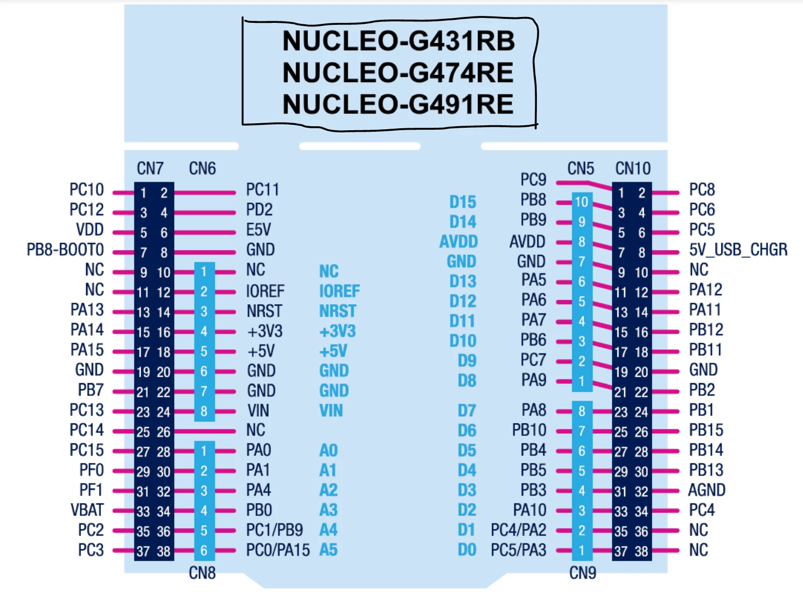

---

## 1. ติดตั้ง Waijung

1. แตกไฟล์ `waijung_18.11a.7z` ออกมาเป็นโฟลเดอร์ `waijung_18.11a`
2. เปิด MATLAB แล้ว `cd` เข้าไปที่โฟลเดอร์ที่แตกไว้
3. รันสคริปต์ติดตั้ง `install_waijung.m` (ดับเบิลคลิก หรือพิมพ์ `install_waijung` ใน Command Window)
4. รอจน MATLAB ติดตั้ง Waijung block library เสร็จ แล้ว restart MATLAB
5. ตรวจสอบว่ามี Waijung library ขึ้นใน Simulink Library Browser

---

## 2. อัปโหลด .bin เข้า STM32

ทำแบบเดียวกันทั้ง 2 ชุดการทดลอง (ครั้งเดียวจบ ไม่ต้องอัปโหลดซ้ำเมื่อเปลี่ยนจาก DC Motor ไป Stepper)

1. เสียบบอร์ด STM32 เข้าคอมพิวเตอร์ผ่านสาย USB จะมี Drive (Mass Storage) ขึ้นมาเหมือน Flash Drive

   

2. ลากไฟล์ `.bin` ไปวางลงใน Drive นั้น
   - DC Motor และ Stepper: `DC Motor and Stepper/motorxplorer.bin`
   - BLDC: `BLDC/BLDC_Explorer.bin`
3. บอร์ดจะกระพริบไฟแล้วรีเซ็ตตัวเองเพื่อรันโปรแกรมใหม่โดยอัตโนมัติ

> ถ้าลองแล้วมีปัญหา ติดต่อพี่ TA 

---

## 3. DC Motor and Stepper (Lab 2.1 / 2.2)

ใช้บอร์ดทดลองตัวเดียวกัน ต่างกันที่ตัวมอเตอร์ที่ต่อและค่าที่ส่งจาก Simulink

### 3.1 การประกอบบอร์ด

#### ส่วน Mechanic: ถอด/ใส่มอเตอร์

ฐานทดลองใช้บอร์ดควบคุมตัวเดียวกัน แต่เปลี่ยนมอเตอร์ได้ 2 แบบ คือ **DC Motor** และ **Stepper Motor** มอเตอร์ยึดกับเพลาผ่าน **Coupling** และสไลด์เข้า-ออกจากฐานได้ ไม่ต้องรื้อทั้งชุด

**การถอดมอเตอร์ออก**

1. ไขสกรูที่ **Coupling** ให้หลวม เพื่อปล่อยเพลามอเตอร์ออกจากเพลาของฐาน

   

2. **สไลด์มอเตอร์ออก** จากฐาน แล้วถอดสายไฟของมอเตอร์ตัวเดิมออก

**การใส่มอเตอร์ตัวใหม่**

3. **สไลด์มอเตอร์ตัวใหม่เข้า** ไปในฐาน จัดเพลามอเตอร์ให้เข้าไปใน Coupling

   

4. **ขันสกรู Coupling ให้แน่น** แล้วลองหมุนเพลาด้วยมือเบา ๆ ว่าไม่หลุดและไม่มีอาการฝืด
5. เดินสายตามหัวข้อ DC Motor หรือ Stepper Motor ด้านล่าง

#### DC Motor

1. ต่อสายมอเตอร์เข้ากับ **Motor driver** (Cytron MDXX)
2. **ร้อยสายไฟเส้นเดียว** ของมอเตอร์ให้ผ่านรู **Current Sensor** (ใช้วัดกระแสที่ PA1) ให้ร้อยผ่านแค่ 1 เส้นเท่านั้น ห้ามร้อยทั้งคู่ เพราะกระแสไหลเข้า-ออกจะหักล้างกันจนอ่านค่าไม่ได้

   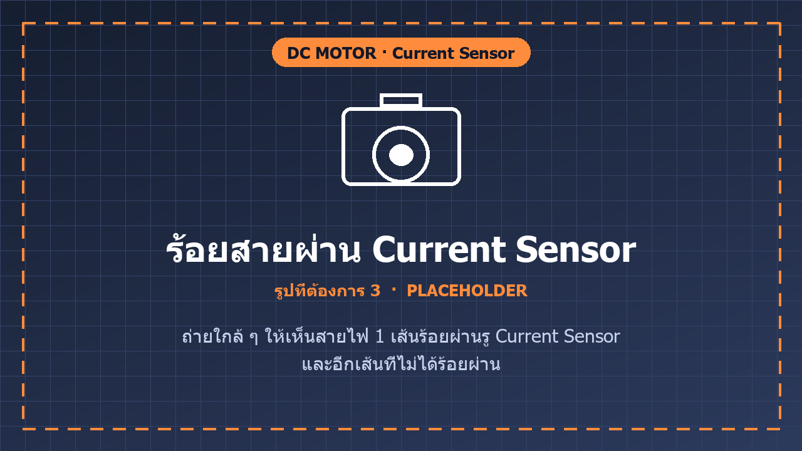

3. ตรวจสอบสายทุกเส้นว่าแน่นหนา แล้วต่อ Encoder เข้าที่ PA6 / PA7

   

#### Stepper Motor

1. มอเตอร์ Stepper (แบบ 2 เฟส) มี 4 สาย แบ่งเป็น **คู่ A** และ **คู่ B** (คอยล์ 2 ชุด) ต่อสายแต่ละคู่เข้ากับขั้ว **A** และ **B** ของบอร์ดให้ตรงกัน

   

2. ถ้าไม่ทราบว่าสายไหนคู่กัน ให้เช็คด้วย **Multimeter** ก่อนต่อ
   - ตั้ง Multimeter ที่โหมด **Continuity** (วัดความต่อเนื่อง ไอคอนรูปลำโพง/ไดโอด)
   - แตะ probe ที่สายทีละคู่ ถ้ามีเสียงบี๊บหรือค่าความต้านทานต่ำ แปลว่าสองเส้นนั้นเป็น**คอยล์เดียวกัน (คู่เดียวกัน)**
   - สายที่เหลืออีก 2 เส้นคืออีกคู่
   - ถ้าสลับขั้วภายในคู่เดียวกัน มอเตอร์จะหมุนกลับทิศ แต่ถ้าสลับสายข้ามคู่ มอเตอร์จะสั่นหรือไม่หมุน

   

3. หลังต่อเสร็จ ตรวจสอบสายให้แน่นหนาก่อนจ่ายไฟ

> **หมายเหตุสำหรับ TA:** รูปพื้นหลังสีน้ำเงิน-ส้มใน `docs/images/ph_*.png` เป็น placeholder บอกว่าต้องถ่ายรูปอะไร ให้แทนที่ด้วยรูปจริงโดยใช้ชื่อไฟล์เดิม แล้วลบหมายเหตุนี้

### 3.2 Pin Mapping

| หน้าที่ | Peripheral | Pin | หมายเหตุ |
|---|---|---|---|
| DC motor PWM (Cytron MDXX) | TIM8_CH2 | PC7 | สัญญาณ PWM |
| DC motor DIR | GPIO | PC6 | เลือกทิศทาง |
| Stepper STEP (DRV8825) | TIM20_CH3 | PC8 | ความถี่ step |
| Stepper M0 / M1 / M2 | GPIO | PB15 / PB14 / PB13 | เลือก microstep |
| Stepper DIR / EN | GPIO | PB2 / PB1 | ทิศทาง / enable |
| Encoder A / B | TIM3_CH1 / CH2 | PA6 / PA7 | Quadrature 8192 PPR |
| ADC Load cell | ADC1_IN1 | PA0 | อ่านแบบ raw 12 bit (0-4095) |
| ADC Current | ADC1_IN2 | PA1 | อ่านแบบ raw 12 bit (0-4095) |
| UART ไป PC | LPUART1 | PA2 / PA3 | 2,000,000 baud ผ่าน ST-Link Virtual COM |

### 3.3 การตั้งค่า Simulink

เปิดไฟล์ `DC Motor and Stepper/MotorXploer.slx` แล้วตั้งค่าดังนี้

1. **Host Serial Setup** (aMG USB Converter N block)
   - ตั้ง **COM Port** ให้ตรงกับพอร์ตที่ ST-Link Virtual COM Port ปรากฏ (ดูได้จาก Device Manager)
   - Baud rate: `2000000`, Data bits: `8`, Parity: `None`, Stop bit: `1`
2. **Fixed-step Solver** (Simulation → Model Configuration Parameters → Solver)
   - Type: **Fixed-step**, Solver: `discrete (no continuous states)`
   - Fixed-step size: `0.001` วินาที (ตรงกับรอบส่งข้อมูลของบอร์ด 1 kHz)
3. กด **Run** เพื่อเริ่มรับข้อมูล real-time จากบอร์ด

### 3.4 Data Flow

**บอร์ด → Simulink** (block Host Serial Rx, ส่งทุก 1 ms)

| Output ใน Simulink | ความหมาย | แหล่งที่มา |
|---|---|---|
| Motor Angular Velocity | ความเร็วเชิงมุมมอเตอร์ (rad/s) | Encoder (PA6/PA7) |
| Load Cell (PA0) | ค่า ADC ดิบของ Load cell | PA0 |
| Current (PA1) | ค่า ADC ดิบของเซนเซอร์กระแส | PA1 |
| PWM Range (echo) | ค่า PWM range ที่บอร์ดรับไปจริง | echo จากคำสั่ง |
| Stepper Frequency (echo) | ความถี่ step ที่บอร์ดรับไปจริง | echo จากคำสั่ง |

ค่า ADC เป็นค่าดิบ (ยังไม่แปลงเป็นหน่วยแอมป์ หรือกรัม) ต้องทำ Signal Conditioning / Calibration เองใน Simulink

**Simulink → บอร์ด** (block Host Serial Tx)

| ค่าที่ส่ง | ชนิด | ใช้ทำอะไร |
|---|---|---|
| PWM Range | single | Duty ของ DC motor |
| Motor frequency | single | ความถี่ PWM ของ DC motor |
| Stepper frequency | single | ความถี่ step ของ Stepper |
| M0, M1, M2 | int16 | เลือกโหมด microstep ของ DRV8825 |
| DIR | int16 | ทิศทางของ Stepper |
| EN | int16 | เปิด/ปิดไดรเวอร์ Stepper |

---

## 4. BLDC (Lab 2.3)

### 4.1 อุปกรณ์

- BLDC Motor 1 อัน
- STMicroelectronics X-NUCLEO-IHM08M1 1 อัน
- Nucleo STM32G474RE พร้อมสายอัปโหลด 1 ชุด
- BLDCXplorer 1 ชุด (ฐานบรรจุบอร์ดควบคุม, Breadboard, ชิ้นส่วน 3D-Print สำหรับประกอบกับ BLDC Motor)

### 4.2 Hardware Setup

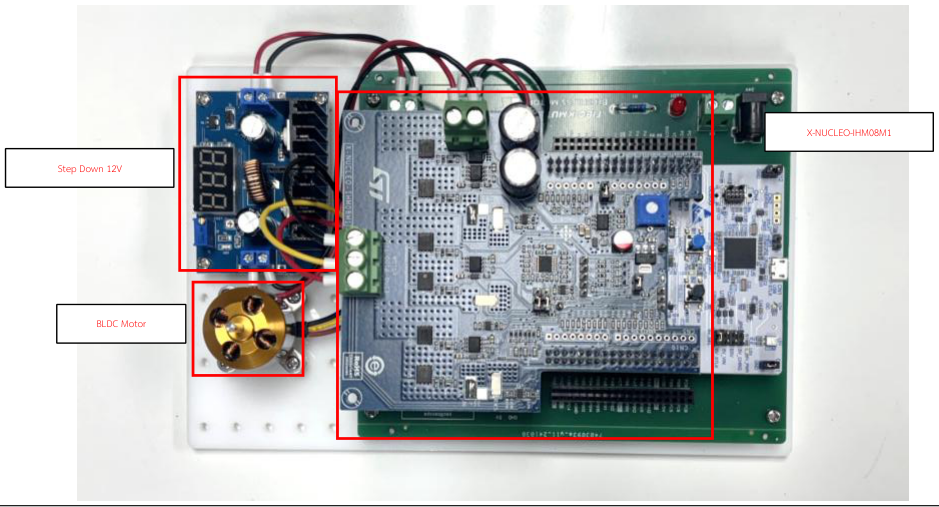

1. นำ Adapter 24V ที่แจกไปต่อเข้ากับช่อง DC Jack บนบอร์ด
2. ตรวจสอบสายไฟทุกเส้นที่ติดตั้งมาว่าแน่นหนาหรือไม่

### 4.3 MC Workbench Setup

1. ติดตั้ง **MC Workbench** (Latest Version) จาก <https://www.st.com/en/embedded-software/x-cube-mcsdk.html>

   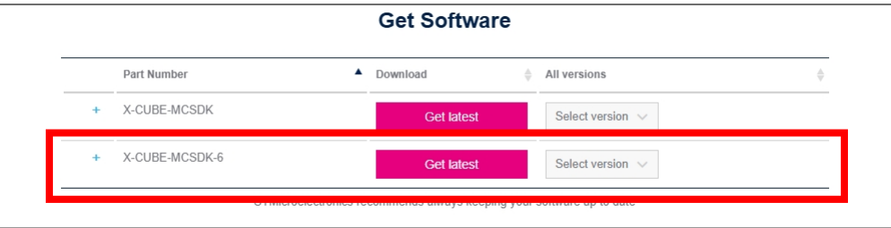

2. Clone repository นี้ลงเครื่อง จะมี `.bin` แนบมาด้วย (`BLDC/BLDC_Explorer.bin`)

   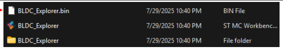

3. ลาก `.bin` ไปวางใน Drive `NOD_G474RE` ที่ปรากฏในคอมพิวเตอร์ (ขั้นตอนข้อ 2)

   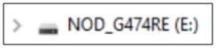

4. ถ้าขึ้นว่าพื้นที่เหลือไม่เพียงพอ ให้ Upload Empty Project เข้าไปก่อน (สร้างเองได้) แล้วลองวางไฟล์ใหม่อีกรอบ

### 4.4 การควบคุมมอเตอร์ด้วย Motor Pilot

1. เปิดไฟล์ `BLDC/BLDC_Explorer.stwb6` ด้วย MC Workbench

   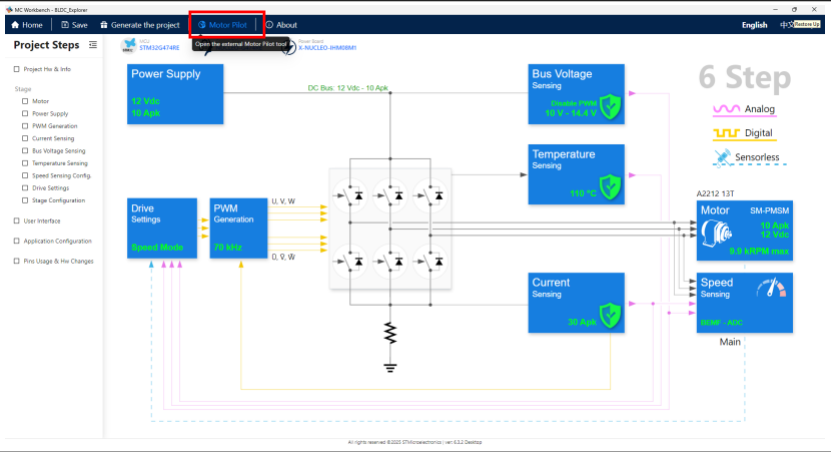

2. กดปุ่ม **Motor Pilot** เพื่อเปิดแถบควบคุม

   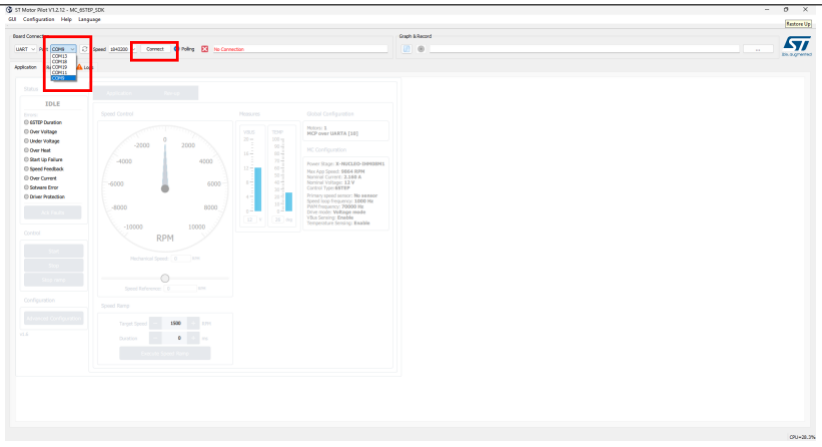

3. เลือก COM Port ที่เชื่อมกับ STM32G474RE แล้วกด **Connect**
4. เลื่อน Slider Bar เพื่อปรับความเร็ว แล้วกด **Start** มอเตอร์จะค่อย ๆ ramp ความเร็วขึ้นจนถึงค่าที่กำหนด

   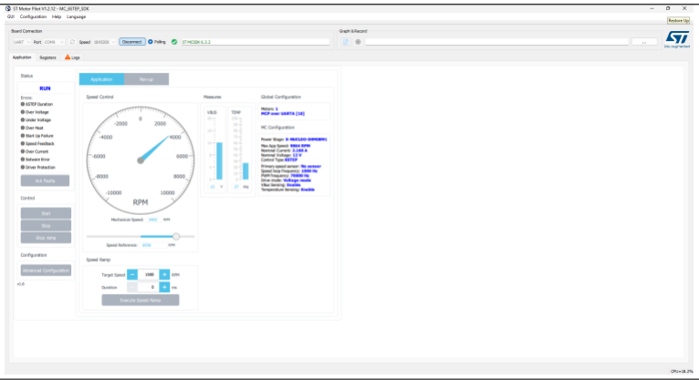

ถ้าต้องการดูหรือแก้โปรเจกต์เฟิร์มแวร์: เปิด `BLDC/BLDC_Explorer/STM32CubeIDE/` ด้วย STM32CubeIDE

### 4.5 การใช้งาน Oscilloscope 4 Channel MICSIG

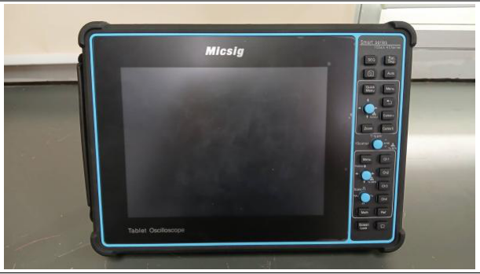 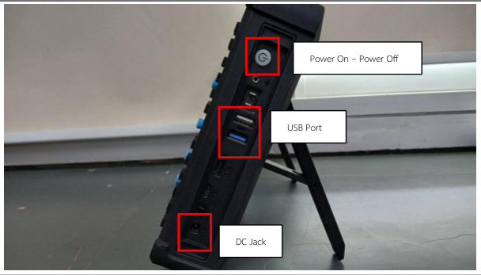 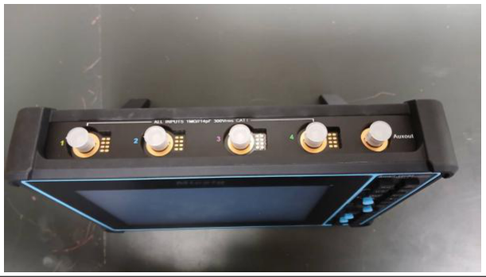

1. นำที่ครอบช่องเสียบสายออก แล้วต่อสายให้ครบ 3 เส้น (สีไม่จำเป็นต้องตรงกับช่อง)

   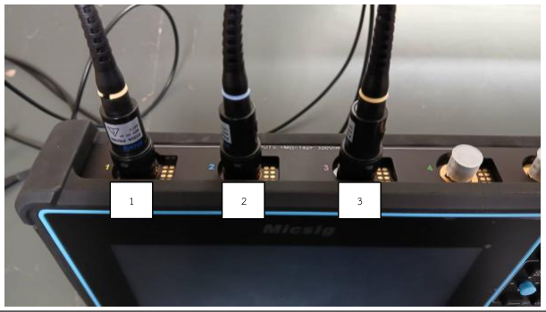

2. นำ Probe ไปเกี่ยวกับจุดวัดที่บอร์ด เรียงช่องให้ถูกต้องตามเลขที่กำกับ พร้อมเกี่ยว GND ด้วย

   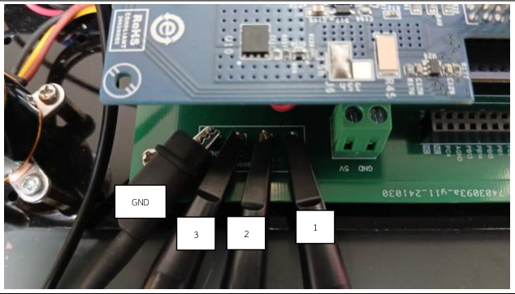

3. เมื่อสั่งให้มอเตอร์หมุน จะได้ภาพตามตัวอย่าง ปุ่มที่ใช้บ่อย

   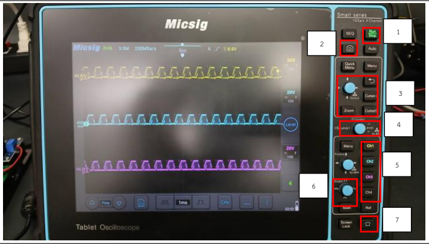

   | # | ปุ่ม | ใช้ทำอะไร |
   |---|---|---|
   | 1 | Run-Stop | ให้ภาพเคลื่อนไหวหรือหยุดนิ่ง |
   | 2 | Screen Shot | เก็บรูปหน้าจอ ณ ขณะนั้น |
   | 3 | Vertical Cursor | วัดความถี่และคาบ |
   | 4 | Trigger Level | ทำให้สัญญาณหยุดนิ่ง |
   | 5 | Channel Selection | เลือก Channel ก่อนเปลี่ยน Scale |
   | 6 | Scaling | เปลี่ยน Scale แกนตั้ง (Volt) และแกนนอน (เวลา) |
   | 7 | Home | ออกจากโปรแกรม |

### 4.6 การนำรูปมาวิเคราะห์สัญญาณ

1. กด **Screen Shot** เพื่อบันทึกรูป

   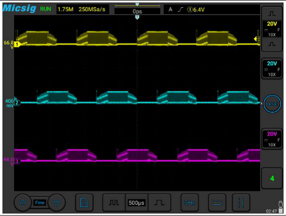

2. กด **Home** แล้วเข้า **File**

   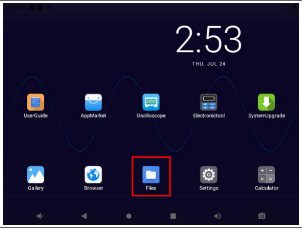

3. รูปจะถูกบันทึกที่ `Images/Screenshots`

   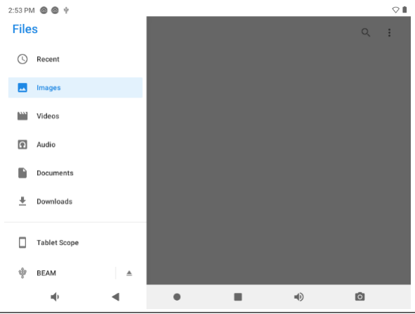 

4. เลือกรูปที่ต้องการ เสียบ Flash drive แล้วกด **Move To** เพื่อย้ายไปเก็บ

   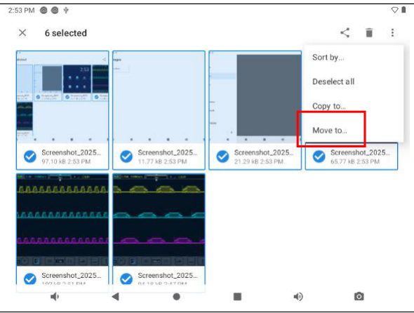 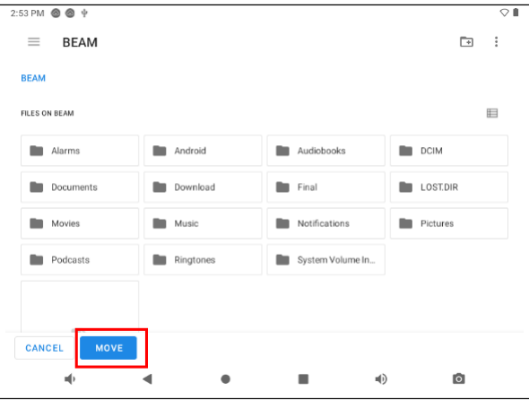

---

หากมีปัญหาในการทำ Lab ติดต่อพี่ TA 
